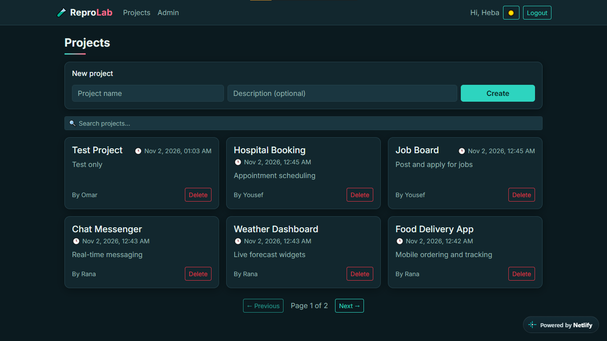
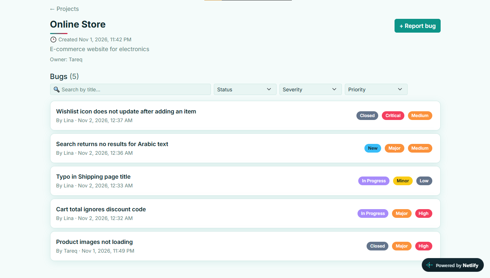
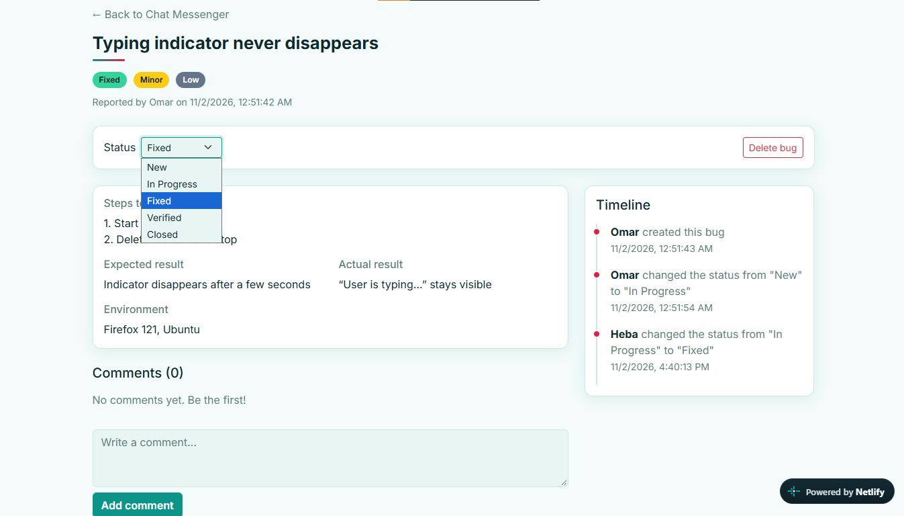
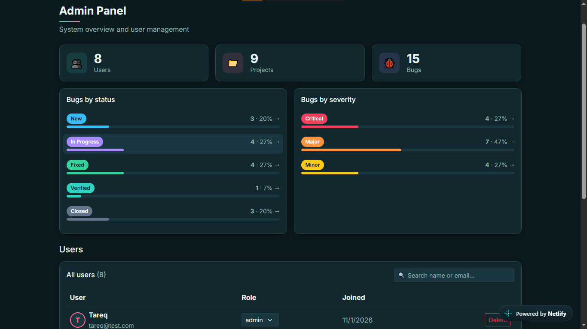

# 🧪 ReproLab

A bug tracking web app built with the MERN stack, as my final project for the **DOT Jordan Full-Stack Web Development Bootcamp**.

Reporting a bug as "the login doesn't work" wastes everyone's time. ReproLab asks for the details that make a bug reproducible: steps to reproduce, expected vs. actual result, environment, severity and priority.

🌐 **Live demo:** https://reprolab.netlify.app
🔗 **API:** https://reprolab.onrender.com
🎥 **Video demo:** []

> The backend runs on Render's free tier, so the first request after a period of inactivity can take up to ~50 seconds.

### Demo accounts
| Role | Email | Password |
|---|---|---|
| Admin | `admin@test.com` | `123456` |
| User | `a@test.com` | `123456` |

---

## 📸 Screenshots

| Projects | Project bugs |
|---|---|
|  |  |

| Bug details | Admin panel |
|---|---|
|  |  |

---

## ✨ Features

- Register and login with **JWT** authentication; passwords hashed with **bcrypt**
- **Roles** (`user`, `admin`) with ownership checks: users can only edit or delete what they created
- **Projects** and **Bugs** with full CRUD
- Bug status workflow: `New → In Progress → Fixed → Verified → Closed`
- **Search, filters and pagination** on projects, bugs and users
- **Comments** on bugs and an **activity timeline** of status changes
- Screenshot upload for bugs (Cloudinary)
- **Admin panel**: statistics, clickable breakdowns, user management and a list of all bugs across projects
- Input **validation** on the backend (and basic checks on the frontend)
- **Dark/light theme**, responsive layout (mobile, tablet, desktop)

---

## 🛠️ Tech Stack

| Part | Technologies |
|---|---|
| Frontend | React (Vite), React Router, React-Bootstrap |
| Backend | Node.js, Express 5, Mongoose |
| Database | MongoDB Atlas |
| Auth | JSON Web Tokens, bcrypt |
| Images | Cloudinary (unsigned uploads) |
| Hosting | Netlify (frontend), Render (backend) |

---

## 📂 Project Structure

```
reprolab/
├── backend/
│   ├── config/        # DB connection, constants
│   ├── controllers/   # business logic
│   ├── middleware/    # auth and validation
│   ├── models/        # Mongoose schemas
│   ├── routes/        # API routes
│   ├── utils/         # helpers
│   └── server.js
└── frontend/
    └── src/
        ├── api/         # fetch wrapper that adds the JWT
        ├── components/  # reusable UI (Navbar, Badge, Pagination...)
        ├── context/     # Auth, Toast and Theme providers
        ├── hooks/       # useDebounce
        ├── pages/       # one file per page
        └── utils/       # constants, helpers
```

The backend follows an **MVC** structure: `Route → Middleware → Controller → Model`.

---

## 🔌 API Overview

Base URL: `https://reprolab.onrender.com/api` (🔒 = needs a token, 👑 = admin only)

| Area | Endpoints |
|---|---|
| Auth | `POST /auth/register`, `POST /auth/login`, `GET /auth/me` 🔒 |
| Projects 🔒 | `GET/POST /projects`, `GET/PUT/DELETE /projects/:id` |
| Bugs 🔒 | `GET/POST /projects/:projectId/bugs`, `GET/PUT/DELETE /bugs/:id`, `GET /bugs/:id/activity` |
| Comments 🔒 | `GET/POST /bugs/:id/comments`, `DELETE /comments/:id` |
| Admin 👑 | `GET /admin/users`, `PUT /admin/users/:id/role`, `DELETE /admin/users/:id`, `GET /admin/stats`, `GET /admin/bugs` |

List endpoints accept `search`, `page`, `limit`, and (for bugs) `status`, `severity`, `priority`.

---

## 🚀 Run Locally

**Requirements:** Node.js 18+ and a MongoDB Atlas database.

```bash
git clone https://github.com/hebaalshannaq-coder/reprolab.git
cd reprolab
```

### Backend
```bash
cd backend
npm install
```
Create `backend/.env`:
```env
PORT=5000
MONGO_URI=your_mongodb_connection_string
JWT_SECRET=your_long_random_secret
SALT_ROUNDS=10
FRONTEND_URL=http://localhost:5173
```
```bash
npm run dev
```

### Frontend
```bash
cd frontend
npm install
```
Create `frontend/.env`:
```env
VITE_API_URL=http://localhost:5000/api
VITE_CLOUDINARY_CLOUD_NAME=your_cloud_name
VITE_CLOUDINARY_UPLOAD_PRESET=your_unsigned_preset
```
```bash
npm run dev
```
Open `http://localhost:5173`.

### Creating the first admin
Registration always creates a normal user (so nobody can make themselves admin). Register, then change that user's `role` to `"admin"` in MongoDB Atlas.

---

## 🔐 Security Notes

- Passwords are hashed; the API never returns them.
- `role` cannot be set from the request body when registering.
- Every protected route checks the JWT; admin routes also check the role.
- Fields that can be updated are whitelisted, and filter values are validated.
- Secrets live in `.env` files, which are not committed (see `.env.example`).

---

## 📚 What I Learned

- Designing a REST API with MVC structure, middleware and validation
- Authentication vs. authorization, and why frontend checks are not enough
- Connecting React to an API: Context, protected routes, `useEffect` with filters and pagination
- Deploying a full-stack app (Atlas, Render, Netlify) and fixing CORS and environment issues
- Debugging with Postman, browser DevTools and server logs

## 🔭 Possible Improvements

- Let the assigned developer change a bug's status
- Real-time notifications and email alerts
- Automated tests
- Multiple screenshots per bug

---

## 👩‍💻 Author

**Heba Alshannaq**
DOT Jordan Full-Stack Web Development Bootcamp
GitHub: [@hebaalshannaq-coder](https://github.com/hebaalshannaq-coder)